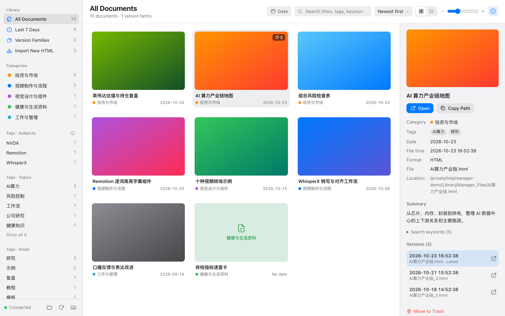
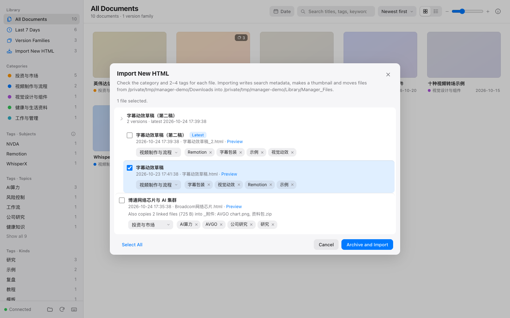
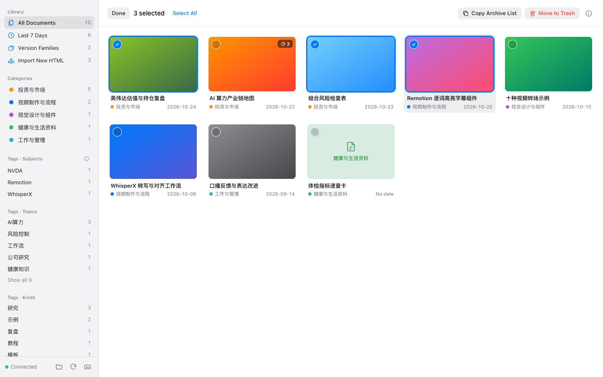
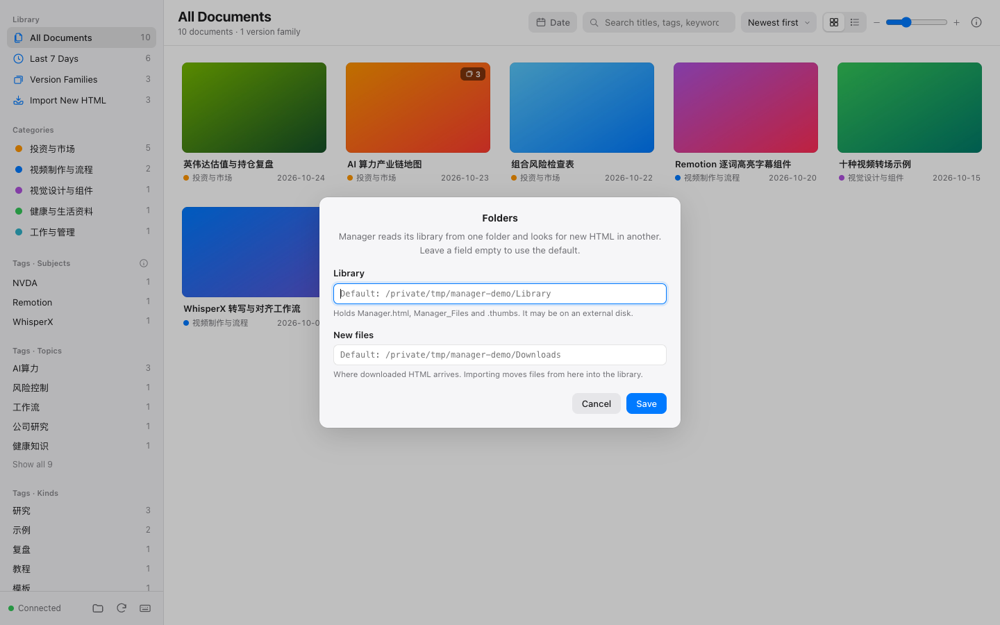
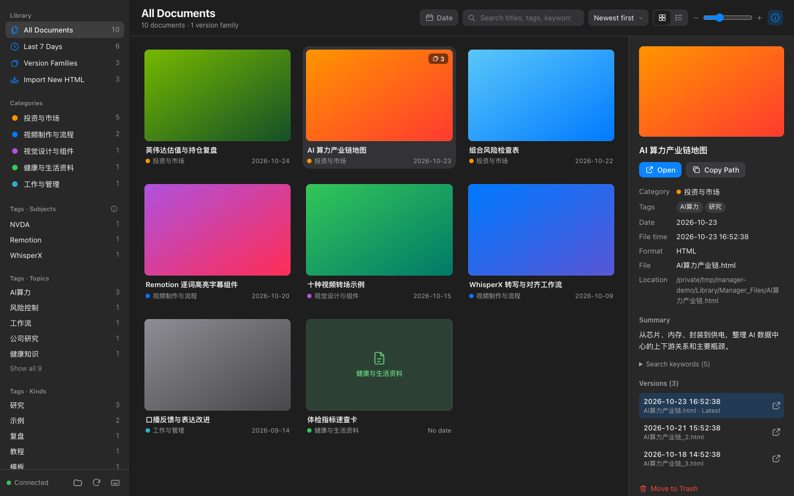

# Manager · Local HTML Library

**English** | [中文](README.zh-CN.md)

A Chrome extension for the **HTML documents** you keep on your Mac: analysis cards and charts made by AI,
research notes, saved web pages, small interactive demos…
Search them in one page, browse by category and tag with thumbnails, and import new HTML files from your Downloads folder into a library.

The look and feel follow Apple Photos. Everything happens on your own Mac.


<sub>Screenshots use generated sample documents.</sub>

> **Status:** v1.5. macOS 13 or later only. Works in Google Chrome, and also in Edge, Brave, Arc and Vivaldi.
> The interface is in English and Chinese and follows your browser's language.

---

## Why

More and more of what AI makes for us is a single **HTML file**: an analysis, a chart, a little tool.
They all land in Downloads with names that say little, and Finder can't find them by topic.
Bookmarks only keep links, which break when a file moves.
Manager gives those files a **local library**: title, category, tags, summary and a first-screen thumbnail, searchable and one click away.

## What it does

- **Instant search** across titles, categories, tags, keywords, summaries, dates, file names and paths; several words must all match.
- **Sidebar filters**: All Documents, Last 7 Days, Version Families, each category, and tags grouped as subjects / topics / kinds. Sections fold.
- **Filter by day** with a calendar, sort by newest / oldest / title, grid or list view, adjustable card size.
- **Info panel**: thumbnail, category, tags, dates, path, summary, keywords and every version of the document.
- **Import new HTML**: Manager finds HTML files in Downloads that are not in the library yet. You check the category and 2–4 tags; Manager writes the search details into the file, makes a thumbnail and moves it into the library.
- **Version families**: `report.html`, `report_2.html`, `report (3).html` are grouped, newest first; older versions are kept.
- **Keep the library on an external disk**: the library and the new-files folder are set separately. If the disk is not connected, Manager says so and never falls back to another folder.
- **Select like Photos**: hover and click the circle, ⌘-click, ⇧-click; then copy a list or move to the Trash.
- **Keyboard**: `/` search, arrows move, Return opens, Space shows Info, `⌫` moves to the Trash; press `?` for all shortcuts.
- **Light and dark mode**, following the system.

| Import new HTML | Select several |
|---|---|
|  |  |
| **Folders (library on another disk)** | **Dark mode** |
|  |  |

## Install

Step-by-step guide for non-programmers: **[docs/INSTALL.md](docs/INSTALL.md)**.

In short:

1. Download `html-manager-vX.Y.Z.zip` from [Releases](https://github.com/songxiaofeng1981/html-manager/releases/latest) and unzip it.
2. Run `bash install.sh` from that folder in Terminal.
3. In `chrome://extensions`, turn on Developer mode → **Load unpacked** → choose `~/Applications/Manager HTML/extension`.
4. Click the extension's icon. The first time, click **Create Library**, then **Import New HTML** in the sidebar.

## Everyday use

| To… | Do this |
|---|---|
| Find a document | Type in the search field, or click a category or tag in the sidebar. |
| Open it | Double-click the card, or select it and press Return. It opens in a new tab. |
| See its details | Click the card, then ⓘ at the top right (or press Space). |
| Add newly downloaded HTML | Click **Import New HTML** in the sidebar, tick files, check category and tags, click **Archive and Import**. |
| Throw something away | Select it and click **Move to Trash** (or press `⌫`). You are asked first; files go to the macOS Trash. |
| Move the library to an external disk | Click the folder button at the bottom of the sidebar (**Folders**). |
| See every shortcut | Press `?`. |

## Where things are

| Place | What's there |
|---|---|
| **Library** (Downloads by default; can be changed) | `Manager_Files/` (imported HTML and `_附件/` for linked files), `.manager/` (the index and its backups; hidden), `.thumbs/` (thumbnails) |
| **New-files folder** (Downloads by default; can be changed) | HTML files that are not imported yet |
| `~/Library/Application Support/Manager HTML/` | The helper and your folder settings |

Each document's category, tags and summary are stored inside the file itself, in `<script type="application/json" id="doc-meta">`, so they travel with it.
The index in `.manager/index.json` only makes the page fast: it is backed up before every change (the last 10 are kept), and
if it is lost or damaged Manager rebuilds it from the files. **Folders → Rebuild Index…** does it by hand.
Nothing is kept in Chrome, so removing the extension or moving to another browser or Mac loses nothing.

## Privacy and safety

- **Nothing leaves your Mac.** Neither the extension nor the helper makes network requests.
- **Only HTML in the library and the new-files folder.** The helper refuses other paths, hidden files and symbolic links.
- **Thumbnails come from macOS Quick Look**, like Finder's previews: the page's scripts do not run and nothing is loaded from the web.
- **Nothing is deleted outright.** Move to Trash uses the macOS Trash, and you are always asked first.
- **What it changes:** only when you click Archive and Import does it write search details into the chosen HTML files, move them and update the index.
- **Nothing runs in the background.** Chrome starts the helper when the page opens; it quits when you close the tab.

## Current limits

- **The category and tag vocabulary is the author's** (investing, video production and so on). To use your own, edit both `extension/js/vocab.js` and `helper/ManagerHost.swift`; it can't be edited in the interface yet.
- Thumbnails don't run page scripts, so a page drawn entirely by JavaScript may get a blank or text-only thumbnail.
- Not in the Chrome Web Store yet, so it is loaded in Developer mode.

## Trouble?

See [Trouble?](docs/INSTALL.md#trouble) in the install guide. To check the helper without Chrome, run `bash selftest.sh`.

## How it works

```
Chrome tab (the extension page: HTML, CSS, JavaScript modules, no build step)
   │  Chrome Native Messaging (JSON over stdin/stdout)
   ▼
Manager Helper (Swift; starts and stops with the tab)
   │  read index · find new files · import (details, thumbnail, archive) · Trash · folder settings
   ▼
Library (Manager_Files, .manager/index.json, .thumbs)  ←  new-files folder (new HTML)
```

A Chrome extension can't read or write your files by itself, and macOS protects Downloads and external disks with their own permissions.
So a tiny helper app does the file work. Details and the message protocol: [docs/DESIGN.md](docs/DESIGN.md).

## Contributing

Issues and pull requests are welcome, in English or Chinese. You can run the whole page in a normal browser tab against a sample folder, without installing anything in Chrome. See [CONTRIBUTING.md](CONTRIBUTING.md).

## License

[MIT](LICENSE)
