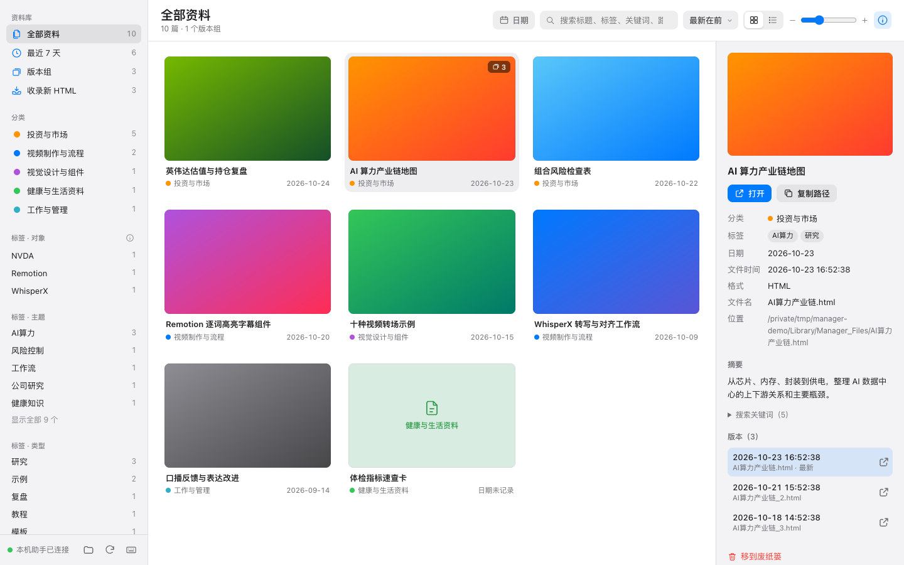
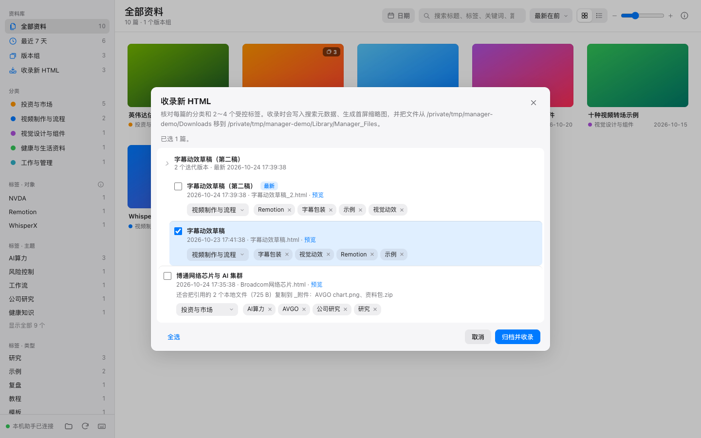
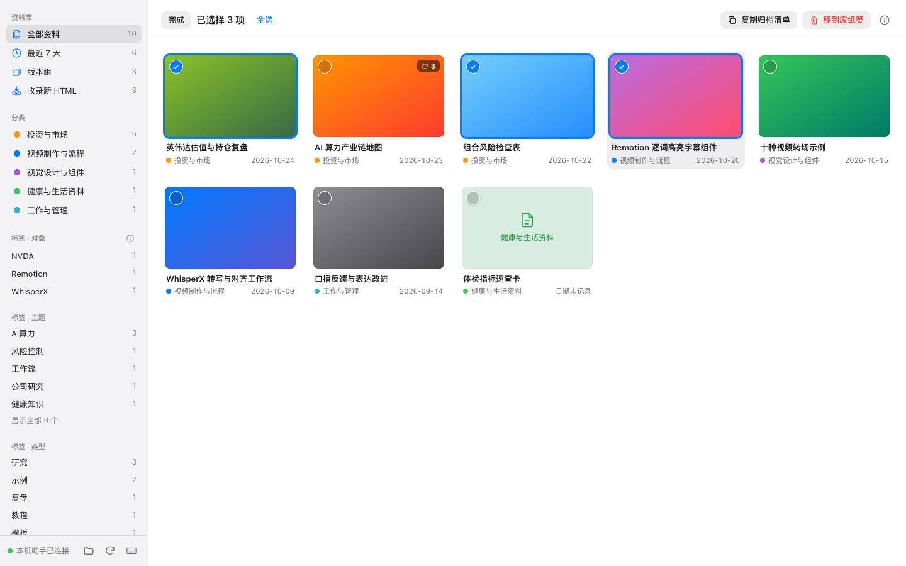
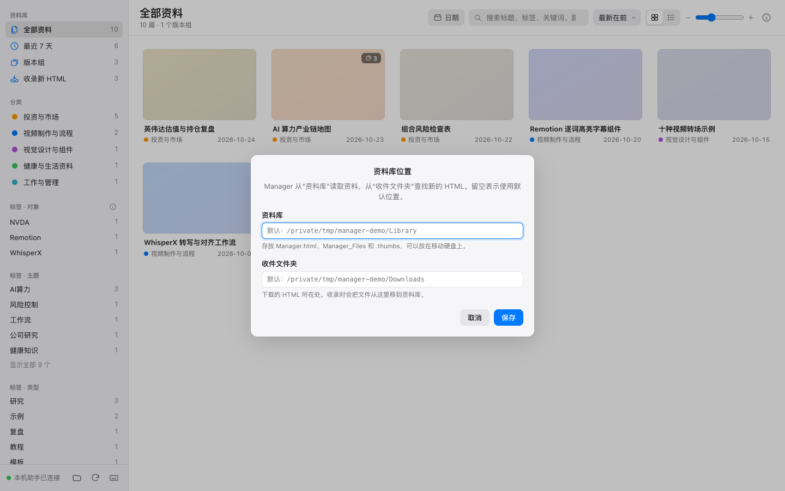
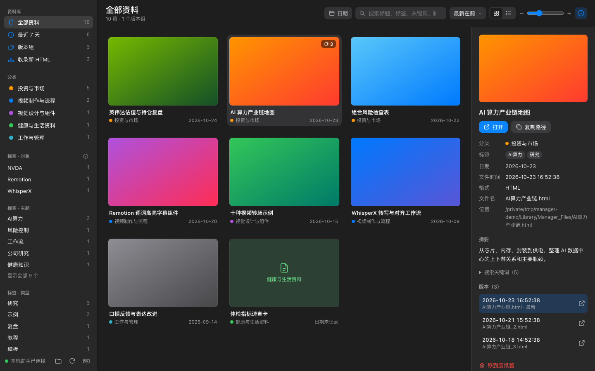

# Manager · 本地 HTML 资料管理

[English](README.md) | **中文**

一个 Chrome 插件，用来管理你保存在 Mac 上的 **HTML 资料**：AI 生成的分析卡片、研究笔记、网页存档、可视化小样……
在一个页面里搜索、按分类和标签浏览、预览缩略图，再把“下载”文件夹里新存的 HTML 收录进资料库。

界面参照 Apple“照片”，所有处理都在你自己的 Mac 上完成。


<sub>截图使用的是生成的示例资料。</sub>

> **状态：** v1.5。只支持 macOS 13 或更新版本。可用于 Google Chrome，也可用于 Edge、Brave、Arc、Vivaldi。
> 界面有中文和英文，跟随浏览器的语言。

---

## 为什么做这个

让 AI 做的分析、图表、小工具，越来越多是一个个 **HTML 文件**。它们都落在“下载”文件夹里，
文件名看不出内容，访达里也没法按主题找。浏览器书签又只记链接，文件一挪就失效。
Manager 给这些文件建一个**本地资料库**：带标题、分类、标签、摘要和首屏缩略图，可以搜索、筛选、一键打开。

## 能做什么

- **即时搜索**：标题、分类、标签、关键词、摘要、日期、文件名和路径，多个词同时匹配。
- **侧边栏筛选**：全部资料、最近 7 天、版本组、按分类、按标签（对象 / 主题 / 类型）；分区可折叠。
- **日历按天筛选**，排序（最新 / 最早 / 标题），网格和列表两种视图，卡片大小可调。
- **信息面板**：缩略图、分类、标签、日期、路径、摘要、关键词，以及同一份资料的所有版本。
- **收录新 HTML**：扫描“下载”里还没收录的 HTML，你核对分类和 2～4 个标签后，Manager 写入搜索信息、生成缩略图，并把文件移进资料库。
- **版本组**：`报告.html`、`报告_2.html`、`报告 (3).html` 这样的同名变体自动成组，最新的在前，旧版本都保留。
- **资料库可以放在移动硬盘上**：资料库和“收件文件夹”分开设置；硬盘没插上时只提示，不会乱用别的文件夹。
- **像“照片”一样多选**：悬停点圆圈、⌘ 点按、⇧ 点按连选，然后复制清单或移到废纸篓。
- **键盘操作**：`/` 搜索、方向键移动、回车打开、空格看信息、`⌫` 移到废纸篓，按 `?` 看全部快捷键。
- **浅色、深色模式**，跟随系统。

| 收录新 HTML | 多选 |
|---|---|
|  |  |
| **资料库位置（可放在移动硬盘）** | **深色模式** |
|  |  |

## 安装

不需要编程基础的分步说明：**[docs/INSTALL.zh-CN.md](docs/INSTALL.zh-CN.md)**。

简单来说：

1. 从 [Releases](https://github.com/songxiaofeng1981/html-manager/releases/latest) 下载 `html-manager-vX.Y.Z.zip` 并解压。
2. 在终端里运行这个文件夹里的 `bash install.sh`。
3. 在 `chrome://extensions` 打开开发者模式 → **加载已解压的扩展程序** → 选择 `~/Applications/Manager HTML/extension`。
4. 点插件图标。第一次用时点 **“新建资料库”**，再点侧边栏的 **“收录新 HTML”**。

## 日常使用

| 想做什么 | 怎么做 |
|---|---|
| 找一篇资料 | 在顶部搜索框输入，或点侧边栏的分类、标签。 |
| 打开 | 双击卡片，或选中后按回车。在新标签页打开。 |
| 看详细信息 | 单击卡片，再点右上角的 ⓘ（或按空格）。 |
| 收录新下载的 HTML | 点侧边栏 **“收录新 HTML”**，勾选、核对分类和标签，点 **“归档并收录”**。 |
| 删掉不要的 | 选中后点 **“移到废纸篓”**（或按 `⌫`），确认后移入 macOS 废纸篓。 |
| 把资料库放到移动硬盘 | 点侧边栏底部的文件夹按钮 **“资料库位置”**。 |
| 查看所有快捷键 | 按 `?`。 |

## 资料放在哪里

| 位置 | 内容 |
|---|---|
| **资料库**（默认“下载”，可改） | `Manager.html`（索引）、`Manager_Files/`（已收录的 HTML 和 `_附件/`）、`.thumbs/`（缩略图） |
| **收件文件夹**（默认“下载”，可改） | 新下载、还没收录的 HTML |
| `~/Library/Application Support/Manager HTML/` | 本机助手和资料库位置设置 |

每篇 HTML 的分类、标签和摘要写在它自己的 `<script type="application/json" id="doc-meta">` 里，换电脑也跟着文件走。

## 隐私与安全

- **数据不出你的 Mac。** 插件和本机助手都不发任何网络请求。
- **只碰资料库和收件文件夹里的 HTML。** 本机助手拒绝这两处以外的路径、隐藏文件和符号链接。
- **缩略图用 macOS 自带的“快速查看”生成**，和访达预览一样：页面里的脚本不会运行，也不会从网上加载内容。
- **从不直接删除。** “移到废纸篓”用的是 macOS 的废纸篓，删除前一定会先问你。
- **会修改什么：** 只有在你点“归档并收录”时，才写入所选 HTML 的搜索信息、移动文件并更新 `Manager.html`。
- **不在后台运行。** 打开管理页时 Chrome 才启动本机助手，关掉标签页它就退出。

## 现在的限制

- **分类和标签词表是作者自己的**（投资、视频制作等主题）。想改成你自己的词表，需要同时修改 `extension/js/vocab.js` 和 `helper/ManagerHost.swift`，还不能在界面里改。
- 缩略图不运行页面脚本，所以完全靠脚本画出来的页面，缩略图可能是空白或只有文字。
- 还没上架 Chrome 应用商店，需要开启开发者模式加载。

## 遇到问题

请看安装说明里的[遇到问题？](docs/INSTALL.zh-CN.md#遇到问题)。不经过 Chrome 检查本机助手：运行 `bash selftest.sh`。

## 工作原理

```
Chrome 标签页（插件页面：HTML、CSS、JavaScript 模块，不需要构建）
   │  Chrome Native Messaging（通过 stdin/stdout 传 JSON）
   ▼
本机助手 Manager Helper（Swift；随标签页启动和退出）
   │  读取索引 · 查找新文件 · 收录（元数据、缩略图、归档）· 移到废纸篓 · 资料库位置
   ▼
资料库（Manager.html、Manager_Files、.thumbs）  ←  收件文件夹（新的 HTML）
```

Chrome 插件本身无法读写你的文件，macOS 也用单独的权限保护“下载”和移动硬盘。所以由一个很小的助手程序负责文件操作。
细节和消息协议见 [docs/DESIGN.zh-CN.md](docs/DESIGN.zh-CN.md)。

## 参与贡献

欢迎提 issue 和 PR，中文英文都可以。不用往 Chrome 里装任何东西，就能在普通浏览器标签页里对着示例文件夹运行整个管理页。见 [CONTRIBUTING.md](CONTRIBUTING.md)。

## 许可证

[MIT](LICENSE)
